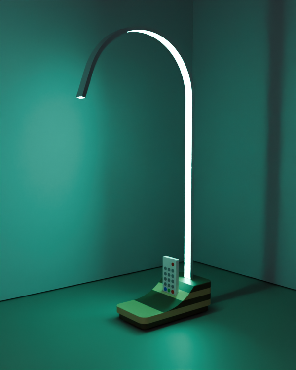
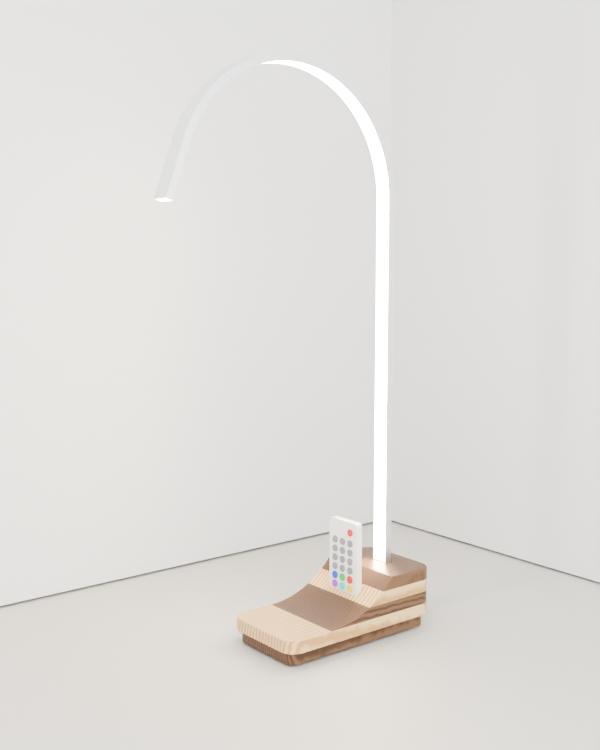
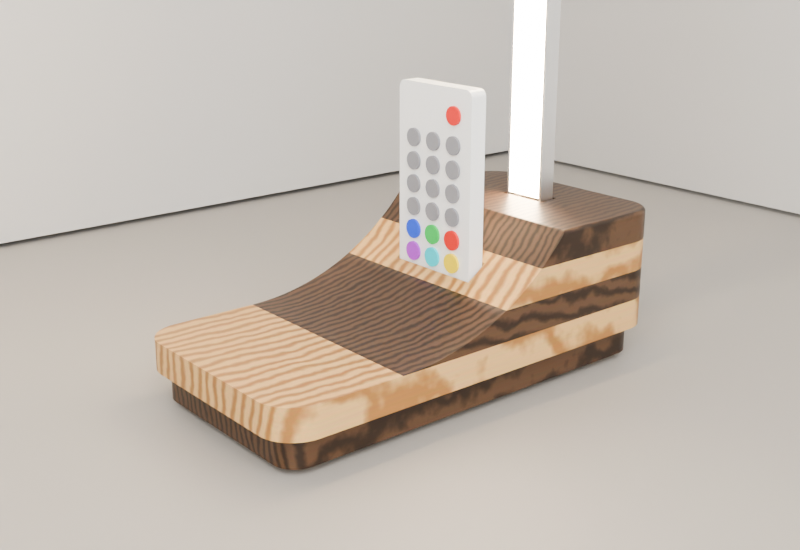
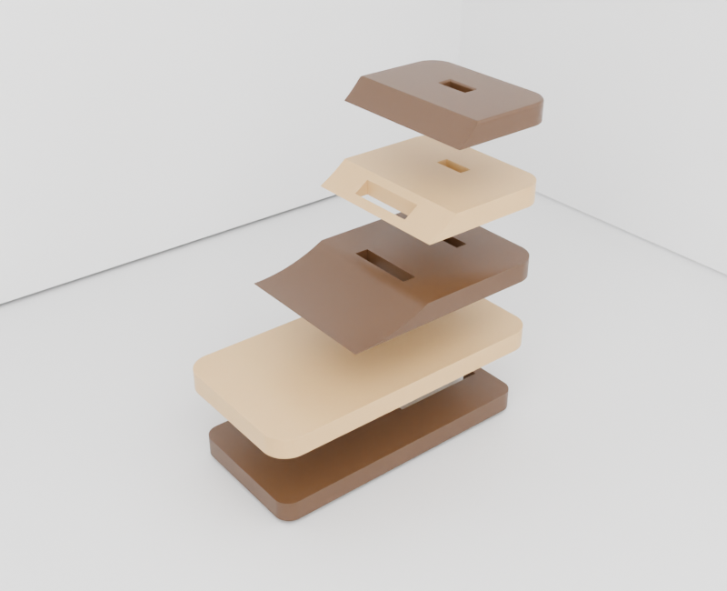

# Strata lamp

An RGB LED desk lamp made from **five 180 × 92 × 12 mm boards** (the parts in `Yellow.ipt` and
`Lamp.ipt`: Yellow Pine and Walnut, 18.0 × 9.2 × 1.2 cm in Inventor) plus a bent aluminium LED channel.

| Glowing (teal) | Daylight |
|---|---|
|  |  |

## The idea

- **Strata base.** All five boards are glued into one 180 × 92 × 60 block, alternating walnut and pine.
  A big R100 cove is cut down from the arm to a low front deck. Cutting through the glue lines turns
  the layers into contour bands that look like strata in rock, which is where the name comes from.
- **Floating shadow line.** The bottom board is trimmed 5 mm smaller all round, so the base seems to hover.
- **Arc arm.** A bendable aluminium LED channel rises 360 mm, curls 160° over at R120 and ends in a
  short tail 96 mm in front of the base. The LEDs face the inside of the curve, so they wash the
  front of the arm and the desk below.
- **Framed remote.** The 17-key RF remote stands in a slot cut into the cove, framed by the arc.
  The USB controller is hidden in a pocket underneath, and the cable leaves through a notch at the back.
- **Simple to make.** Every slot is cut as a window through single 12 mm boards *before* glue-up,
  so there are no deep mortises. The cove is one bandsaw cut through the glued block.

## Files

| File | What it is |
|---|---|
| `out/strata_lamp_templates.pdf` | **Print at 100 %.** Sheet 1: general arrangement, cut list. Sheets 2-4: 1:1 layer templates and side profile. Sheet 5: 1:1 bending former |
| `out/step/strata_lamp_assembly.step` | Whole lamp as an assembly. Opens in **Inventor** (File > Open > STEP), Fusion, Onshape and FreeCAD |
| `out/step/L1_walnut.step` ... `L5_walnut.step`, `arm_channel.step` | Each part on its own |
| `out/strata_lamp.stl` | One-piece mesh (GitHub previews it in 3D) |
| `out/renders/*.png` | Renders (Blender Cycles) |
| `out/report.json` | Masses, centre of mass, tipping angles, channel lengths |
| `params.py` | **Every dimension.** Change it and rerun |
| `strata_lamp.py`, `templates.py`, `render.py` | Generators for the CAD/STEP, the PDF and the renders |
| `make_lamp.bat` | Windows: double-click to rebuild everything after editing `params.py` |

## 1. Measure first (2 minutes)

These parts vary between kits. Measure yours, edit `params.py`, then run `make_lamp.bat` (Windows) or
`make lamp` (Linux/macOS). The templates and STEP files update to match.

| `params.py` | Default | What |
|---|---|---|
| `ch_w`, `ch_d` | 18.9 × 7.0 | Aluminium channel, outside width × depth. Bendable profiles are 17-19 × 5.7-7 (Penn Elcom LEDAL36, Linearlux 1907, Superlighting C-channel). The slot is sized for the biggest, and epoxy fills any gap |
| `rem_l`, `rem_w`, `rem_t` | 86 × 40 × 7 | 17-key mini RF remote (some are 85 × 40 × 6) |
| `ctl_l`, `ctl_w`, `ctl_h` | 50 × 22 × 10 | Inline USB controller box. The pocket fits up to about 58 × 26 × 11 |
| `layers` | `W P W P W` | Bottom to top. If you have 2 walnut + 3 pine, use `P W P W P` |

Check the remote is **RF**, not IR. RF works through the wood. An IR remote needs line of sight to the
controller, so in that case leave the controller outside on the cable.

## 2. Shopping / workshop list

- 5 boards, 180 × 92 × 12 (as supplied)
- USB RGB LED strip kit with RF remote + inline controller. You need about 0.75 m of strip
- 1 m bendable aluminium LED channel (17-19 mm wide) with diffuser
- PVA wood glue, 5-minute epoxy, 4 cork/rubber feet Ø15 × 3, glue stick, masking tape
- Sandpaper 120/180/240, Danish or hardwax oil
- Scrap 18 mm MDF/ply (~250 × 130) for the bending former
- Tools: printer, drill + 6 and 12 mm bits, coping or scroll saw, files/chisels, 4+ clamps, bandsaw,
  disc sander, spindle sander *or* sandpaper wrapped round a ~90 mm pipe/tin, hacksaw

## 3. Build

1. **Print** `out/strata_lamp_templates.pdf` at 100 % (Actual size). The 100 mm bar on each sheet must measure 100 mm.
2. **Mark out.** Glue-stick each layer template onto the *top* face of its board, front edge left.
   Pencil `L1`…`L5` and an arrow to the front on every board's edge.
3. **Cut before glue-up.** Drill a 6 mm hole inside each window corner, saw between the holes with a
   coping or scroll saw, then file to the line. Test each window with an offcut of channel and the remote.
   - **L1 (walnut):** trim 5 mm off every edge (bandsaw, then disc-sand to the heavy line). Cut the
     controller pocket and cable notch. The notch is open at the back edge, so saw straight in from there.
   - **L2 (pine):** drill the Ø12 hole under the arm, for the LED lead.
   - **L3, L4:** arm window 7.6 × 19.5 and remote window 8.5 × 41.5.
   - **L5:** arm window only. The remote window falls in the waste there.
   - Leave the grey "WASTE" areas on. Full boards clamp evenly.
4. **Glue-up.** Spread thin PVA, then stack L1→L5 with the grain running lengthwise.
   To line the windows up, push a taped 7 × 19 mm stick through the arm windows and a taped 8 × 40 stick
   through the remote windows. Clamp with cauls. Wipe squeeze-out out of the windows *now* with a damp
   cotton bud. Pull the sticks out after 20 min and leave it overnight.
5. **True up.** Sand the sides flush, then disc-sand the corners to R14.
6. **Cove.** Glue the side-profile template (sheet 4) on one side. Lay the block on that side and bandsaw
   1 mm outside the line, using a push block. Sand to the line on a spindle sander, or with sandpaper
   on a ~90 mm pipe. This is where the stripes appear. Blend the cove smoothly into the low deck;
   L3 thins to a feather edge there, so sand gently.
7. **Finish.** Break all edges ~1.5 mm, then sand 120 → 180 → 240. Tape over the arm slot and apply
   2-3 coats of oil. Walnut goes rich brown and pine goes honey.
8. **Bend the arm** (sheet 5).
   1. Cut the former from MDF on the solid line and screw it to a scrap board.
   2. Mark the channel **396 mm** from one end. That is the start of the bend.
   3. With the open (LED) side against the former, clamp the straight part tangent at the START mark.
      Pull the channel round slowly to the END mark at 160°. Tape a 6 mm acrylic/MDF strip inside
      the channel while you bend, so the walls don't kink.
   4. Let it spring back and compare with the dashed line. Trim the tail to 50 mm and deburr.
9. **LEDs.** Clean inside the channel with alcohol. Stick the strip in starting from the bottom end and
   leave the lead hanging out of the bottom. Cut the strip at a marked cut line near the tip, then clip in the diffuser.
10. **Wire up.** Feed the lead down the arm slot and through the Ø12 hole into the pocket. Plug it
    into the controller and lay the USB cable in the back notch.
11. **Fix the arm.** Dry-fit first. Then put 5-minute epoxy on the bottom 36 mm of the channel (not on
    the lead) and push it down until it sits on L2. Square it vertical both ways and tape it until set.
12. **Feet and remote.** Stick the four feet ~18 mm in from the L1 corners. Stand the remote in its slot,
    then plug into any USB charger or computer.

## 4. Numbers

From `out/report.json` (walnut 0.64, pine 0.55 g/cm³, channel + strip + diffuser 0.2 kg/m):

| | |
|---|---|
| Overall height | 546 mm |
| Arm tip overhang past the base | 96 mm |
| Channel | 781 mm total: 36 in the base, 745 lit |
| Mass | base 350 g, arm 156 g, total ~530 g |
| Stability | centre of mass is 94 mm behind the front feet. Tips forward only past 36°, backward past 27° |
| Glue line meets the cove at | 95.7 mm (L3/L4) and 113.2 mm (L4/L5) from the front |

## 5. Changing the design

Everything is in `params.py`. Useful knobs:

- `arm_rise`, `arm_r`, `arm_bend_deg`, `arm_tail` change the arm's shape. Keep `arm_r` ≥ 100, the
  smallest radius quoted for bendable channel.
- `sweep_r`, `flat_top_from_x` change how steep the cove is and where it starts.
- `layers` sets the stripe order. `bottom_inset` sets the shadow gap.

Rerun `make_lamp.bat` (or `make lamp && make lamp-render`). Python 3.10-3.13 with `pip install build123d reportlab` is all it needs.

In Inventor, the STEP assembly opens as an `.iam` with one part per layer. To match your original
files, apply the *Walnut - Natural Polished* and *Yellow Pine - Solid Stained Light Low Gloss* appearances.

## Safety

Use a push block on the bandsaw and keep your fingers out of line with the blade. The block is
small, so clamp it to a sled if in doubt. Wear gloves for epoxy and oil, and lay oily rags flat to dry.
The LEDs run on 5 V USB, so the electrics are low-voltage.
