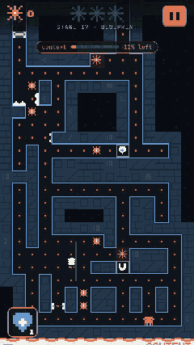
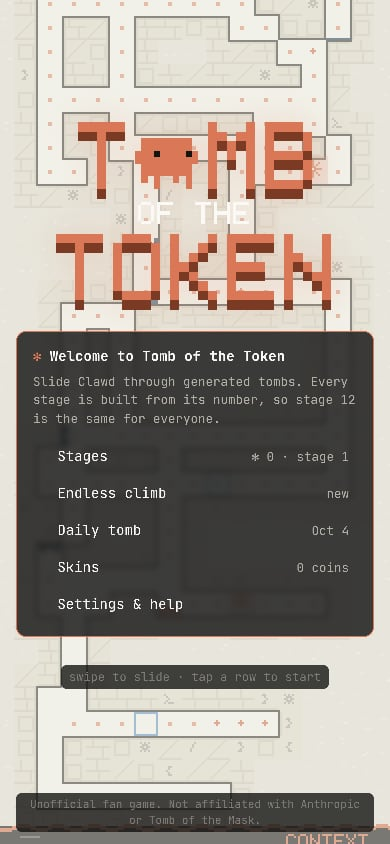
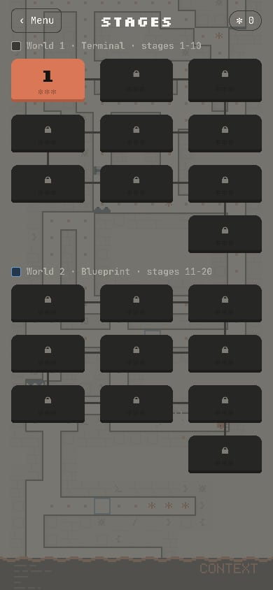
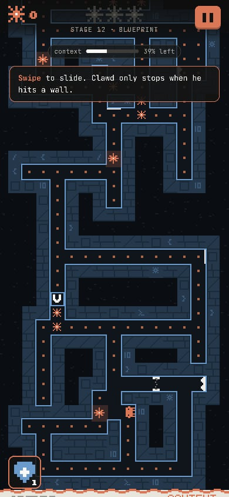
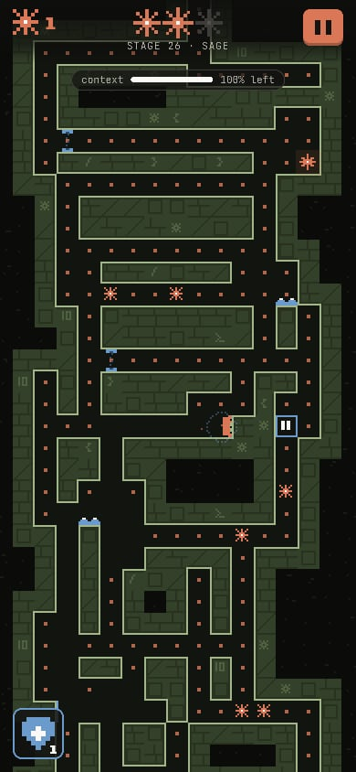
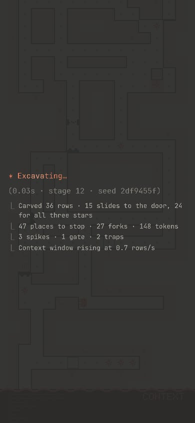
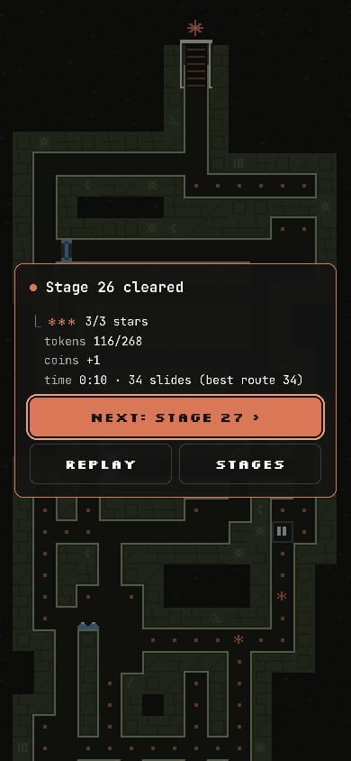
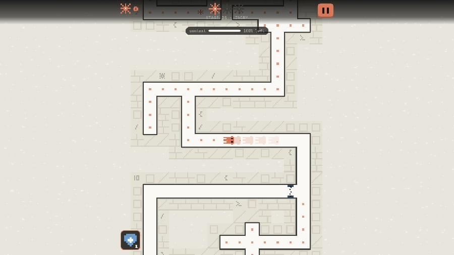

# Tomb of the Token

A Claude-themed slide maze in the style of *Tomb of the Mask*. Clawd slides until he hits a
wall, so every swipe is a commitment. Collect tokens, coins and three stars, dodge spikes, bugs,
gates and traps, and reach the door before the **context window** fills the tomb from below.
Every tomb is **procedurally generated** and checked by a solver before you see it.

| Title | Stage map | World 2 (Blueprint) | World 3 (Sage) |
|---|---|---|---|
|  |  |  |  |
| **Generating a stage** | **Stage cleared** | | |
|  |  | | |

These screenshots and the GIF come from headless Chromium in the cloud sandbox (the GIF is the
autopilot playing stage 17).

## Play it

The build is a single 95 KB HTML file with everything inlined (code, pixel art, sound). It runs
offline, needs no server, and works on phones.

| | How |
|---|---|
| **Windows** | Double-click **`play-tomb.bat`** in the repo root. It builds the game on the first run (installing Node.js LTS with winget if you don't have it) and opens it in your browser. |
| **Linux / macOS** | **`./play-tomb.sh`** (needs Node.js 20+). |
| **Phone** | Turn on GitHub Pages (Settings → Pages → Source: GitHub Actions), run **Actions → deploy to pages**, and open `https://<you>.github.io/<repo>/tomb/`. On iPhone, *Share → Add to Home Screen* gives it a full-screen icon. |
| **No build** | Every push builds **`tomb-of-the-token`** in the **Actions** tab: download it, unzip, double-click the HTML file. |
| **Hacking on it** | `make tomb-dev` (hot reload on http://localhost:5174). |

Links: `#stage-12`, `#endless` and `#daily` jump straight into a stage or mode.

### Controls

| | |
|---|---|
| Slide | Swipe (an L-shaped swipe queues two slides), arrow keys, WASD, HJKL, or a gamepad d-pad/stick |
| Pause | Esc / P, the ⏸ button, or Start |
| Restart | R |
| Mute | M |
| Shield | Tap the shield button (bottom left) to protect Clawd for one hit |

## What's in the tomb

| Thing | What it does |
|---|---|
| **Tokens** (dots) | Fill every corridor. Collecting them quickly plays a rising scale. |
| **Coins** (the ✻ spinner) | Spend them on skins and shields. |
| **Stars** (three per stage) | Your stage rating. They sit on detours. |
| **Exit door** | At the top of each stage. Its spark lights up once you hold all three stars. |
| **Spikes** | Only hurt if you *stop* on them. Sliding past is fine. |
| **Bugs** | Patrol lanes that cross your corridors. Standing still is always safe. |
| **Gates** | Blink, then switch on. Slide through while the line is dotted. |
| **Traps** | Spring half a second after you land. Keep moving. |
| **Context window** | Rises from below on some stages and in endless mode. Keep climbing. |
| **Power-ups** | Shield (one hit), magnet (pulls in tokens and coins), pause (stops every hazard and the context window for 5 s). |

**Modes:** endless **Stages** (five worlds of ten, cycling: Terminal, Blueprint, Sage, Ivory,
Kraft), an **Endless climb** that generates new rooms as you go and speeds the context window up the
higher you get, and a **Daily tomb** that is the same for everyone on a given date. Progress,
coins and skins are saved in the browser.

## How the levels are generated (`src/gen.ts`)

Clawd can't stop in open floor, so a level is really a **directed graph**: the nodes are the cells
where a slide can end, and each node has up to four edges (one per direction). The generator works on
that graph rather than on the picture.

1. **Spine.** A walker carves slides from the entrance to the exit door. It scores each candidate
   move: upward progress, zig-zag turns, and fresh rock rather than corridors pressed against
   existing ones. Each slide ends against a wall that is **locked**, so later carving can't erase
   the guaranteed solution.
2. **Growth.** Spurs (scored over every direction and length from a random stop), loops punched
   through thin walls, rooms and pillars are added one at a time. After each one the slide graph is
   rebuilt and the change is **rolled back** unless:
   - every stop you can reach can still reach the exit (no soft-locks, ever), and
   - the shortest solution hasn't collapsed (shortcuts may not make a stage trivial).

   Rooms are also rolled back if no slide can enter them. Floor that nothing can slide into goes
   back to rock at the end.
3. **Spikes** are placed on wall faces where some slide stops. A spike turns that move into a death
   move, so each one is only kept if the level is still solvable and soft-lock free *without* that
   move, and almost no corridor becomes unreachable.
4. **Moving hazards are fair by construction:**
   - bugs and gates are never placed on a cell where a slide can stop, so standing still is always safe;
   - a bug only patrols a lane that slides cross at right angles (a slide *along* its lane could never dodge it);
   - no single slide crosses more than one moving hazard;
   - traps only go on stops whose every exit is free of movers, so leaving at once is always safe.
5. **Stars** are chosen in order (bottom third, middle, top) along a route that is built as it goes.
   Each star is a detour from wherever the previous star left you, so **all three can always be
   collected in one run**. That route is saved with the level.
6. **The context window** is timed against that star route, with reaction time and a budget for
   waiting at hazards, then given slack.
7. Several candidate layouts are generated per stage and the best is kept, scored on solution
   length, forks, stops per row and floor density. Generation is deterministic (stage *n* is the
   same everywhere) and takes about 10-60 ms.

Endless mode uses the same generator for 24-row chunks. Each chunk enters through a door in the
row it shares with the chunk below. Sliding back down through that door counts as returning to the
chunk's entrance, which is valid because the chunk below was itself verified to lead back up.

### How it's tested

- `npm test`: re-checks every stage from 1 to 200, three daily tombs and 3 × 40 endless chunks
  with an **independent** slide implementation. It confirms the exit is reachable, there are no
  soft-locks, the saved route takes all three stars without dying, movers never cover a stop,
  every pickup is reachable, and generation is deterministic.
- `test/play.test.ts`: a **bot plays every stage from 1 to 200 through the real game rules**
  (bug timing, gates, traps, the rising context window), looking ahead to wait for gaps. It must
  win every stage with 3/3 stars. It also plays the daily tomb and three 4-minute endless runs.
- `npm run e2e`: headless Chromium plays stage 1 of the built file with real **touch swipes**,
  **mouse drags** and **arrow keys**. It checks the result screen, that progress survives a
  reload, the pause menu and `/restart`, endless and daily, and that the page logs no errors.
- `scripts/shots.mjs`: screenshots of every screen at phone and desktop sizes.

`make tomb-test` runs the first two and `make tomb-e2e` builds and runs the browser test. CI runs
all of them on every push.

## The Claude theme

- **Palette** from Anthropic's brand guidelines: `#d97757` clay orange, `#141413` slate,
  `#faf9f5` ivory, `#b0aea5` grey, plus the blue `#6a9bcc` and green `#788c5d` accents. The five
  worlds are built from these, and *Ivory* is a light-mode tomb.
- **Clawd** is the 10×8 pixel mascot, drawn from code so he can squash and stretch. He flies feet
  first, lands on whichever wall he hits (ceiling and walls too), blinks, looks around, taps his
  feet when idle, and comes apart into his own pixels when he dies. Skins recolour him.
- **Spinner:** coins are Claude Code's `· ✢ ✳ ✶ ✻ ✽` spinner, and stage loading shows that
  spinner with its shimmer and real spinner verbs ("Combobulating…", "Flibbertigibbeting…"). The
  numbers shown while it spins are real: generation time, seed, stops, forks and hazards.
- **Terminal UI:** menus are Claude Code panels ("✻ Welcome to Tomb of the Token"), the pause menu
  is slash commands (`/resume`, `/restart`), and results use `⏺` and `⎿` trees.
- **The context window** is the rising flood: a page of text with an orange edge, a
  "context: 42% left" meter, and "Context limit reached" when it catches you.
- **Walls** carry carved code glyphs: `>_`, `{ }`, `✻`, `/`, `10`.

This is an unofficial fan game, not affiliated with Anthropic or with *Tomb of the Mask*
(Happymagenta). All art, sound and code here are original. Sound and music are synthesised with
WebAudio, and the music is a short loop generated per world.

## Files

| File | |
|---|---|
| `src/gen.ts` | Level generator, difficulty curve, slide-motion constants |
| `src/sim.ts` | Game rules (no DOM): world, sliding, pickups, hazards, flood, endless chunks |
| `src/bot.ts` | Autopilot for the title-screen demo and the play test |
| `src/render.ts` | Pixel renderer: cached wall bands, items, hazards, Clawd, particles, flood |
| `src/art.ts` | Palettes, Clawd, bitmaps, 5×7 font, skins |
| `src/audio.ts` | WebAudio sound effects and music |
| `src/input.ts` | Swipes, keys, gamepads |
| `src/main.ts`, `src/style.css`, `index.html` | Screens, HUD, menus and the main loop |
| `scripts/single-file.mjs` | Inlines the Vite build into `dist/tomb-of-the-token.html` |
| `scripts/e2e.mjs`, `scripts/shots.mjs` | Browser test and screenshots |
| `test/` | Generator invariants and the bot play test |
